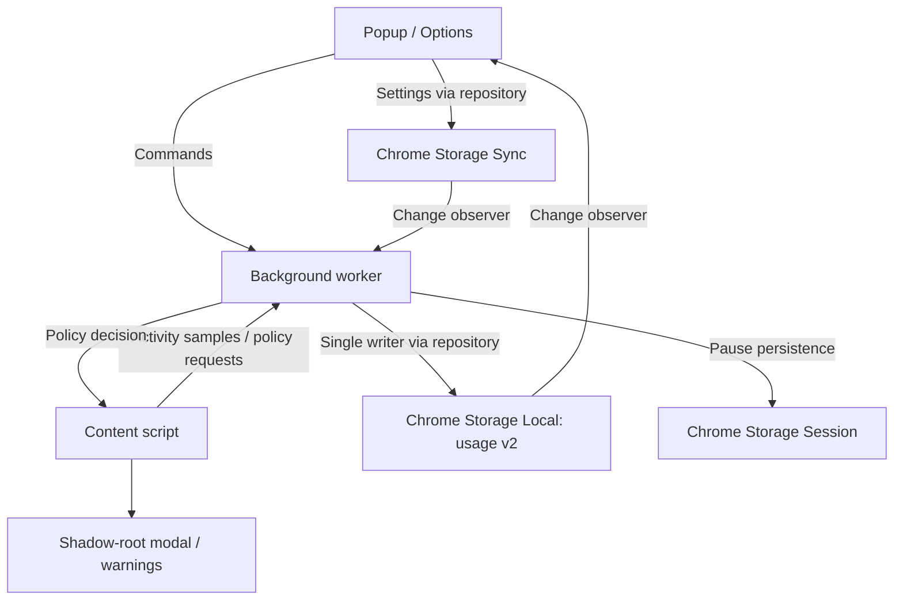

# Architecture Overview

WorkAround is a Manifest V3 Chrome extension. Next.js statically exports the popup
and options pages; esbuild bundles the background worker and content script.

## Responsibilities

- `src/services/ActivityTracker.ts`: observed time intervals, duplicate-domain
  elimination, gap protection and local-midnight splitting. It does not access
  browser APIs or storage.
- `src/services/policies.ts`: pure policy evaluation, settings defaults and legacy
  normalization, URL exceptions, overlapping group budgets, allowed hours,
  overnight focus schedules, and access extensions.
- `src/data/ChromeStorageRepository.ts`: versioned usage persistence, one-time
  migration, 30-day retention, serialized mutations, settings and preferences.
- `src/background/index.ts`: the only writer of usage data. Serializes browser
  events and commands; observes the active window, active tab and system idle
  state; combines media reports with the browser's audible state. Sampling is
  throttled to four seconds, with exact observed tab/focus transitions committed
  separately. A gap over 12 seconds is discarded. Worker restarts start a fresh
  observation instead of reconstructing elapsed wall time.
- `src/content/index.ts`: reports playback, requests policy decisions and renders
  warnings or a native modal dialog in a shadow root. The page DOM is preserved.
  Visible pages check every second; hidden pages report every five seconds,
  subject to browser timer throttling. Entry countdowns require foreground use.
- `src/hooks`: settings, preferences and activity subscriptions for React.
- `src/components/ProductivitySettings.tsx`: groups, URL exceptions,
  tracking controls and confirmed session corrections.
- `src/components/FocusPanel.tsx`: schedule list, preset previews and day/time
  editor. `src/services/focus.ts` validates schedule creation and edits.
- `src/services/PinService.ts`: local PIN configuration, PBKDF2 verification,
  protected-domain matching and persistent attempt throttling. Management and
  extension-grant commands run through the background queue.
- `src/hooks/usePinSettings.ts`: public PIN status subscriptions and management
  commands. UI contexts receive configuration metadata, never credentials.

## Data and compatibility

`workaround_settings` remains in sync storage. Optional new fields are normalized
at the repository boundary, so existing installations keep their limits and
schedules. A legacy disabled master switch initially disables both tracking and
blocking; afterwards they can be configured independently.

`workaround_usage_v2` in local storage holds observed session intervals and daily
extension grants. Consecutive intervals of one domain/source/day are coalesced.
Per-domain totals and group totals are derived from these records, so deleting a
session corrects every relevant budget without maintaining divergent counters.
Group totals use interval unions. Imported legacy daily totals have no known
interval and are additive. The legacy `workaround_stats` key is retained as a
migration backup and is no longer written.

`workaround_activity_v2` in session storage holds the temporary manual pause.
Unconfirmed timestamps from older workers are never restored as billable time.

`workaround_pin_v1` in local storage holds a random 16-byte salt, PBKDF2-SHA-256
hash (600,000 iterations), protected domains and failed-attempt/lock state. The
credential and selection stay on the same device. A five-attempt lock lasts one
minute. PIN changes, domain changes and removal require verification. Only
extension UI senders can manage protection; website content scripts can request
policy decisions and attempt time extensions for their own tab. The background
derives the hostname from the browser tab and verifies any required PIN before
persisting a grant. Public status contains no salt or hash. A PIN does not bypass
other policy decisions, and does not prevent the browser owner from disabling
the extension or editing extension data.

## Build and verification

`npm test` bundles and runs deterministic policy, repository, tracker and mocked
background integration tests using Node's test runner. `npm run build` generates
`out`, patches static resource paths and extracts inline scripts for extension
CSP. `node scripts/validate-build.js` checks the final package.
