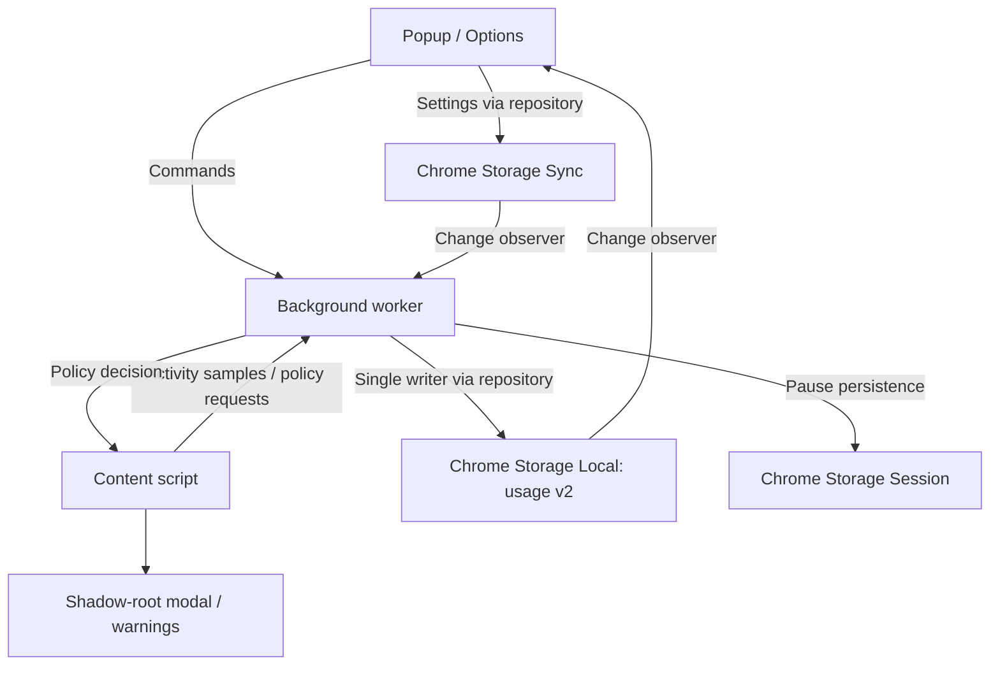

# Architecture Overview

WorkAround is a Manifest V3 Chrome extension. Next.js statically exports the popup
and options pages; esbuild bundles the background worker and content script.

## Responsibilities

- `src/services/ActivityTracker.ts`: observed time intervals, duplicate-domain
  elimination, gap protection and local-midnight splitting. It does not access
  browser APIs or storage.
- `src/services/policies.ts`: pure policy evaluation, settings defaults and legacy
  normalization, URL exceptions, overlapping group budgets, allowed hours,
  overnight focus schedules, and access extensions.
- `src/data/ChromeStorageRepository.ts`: versioned usage persistence, one-time
  migration, 30-day retention, serialized mutations, settings and preferences.
- `src/background/index.ts`: the only writer of usage data. Serializes browser
  events and commands; observes the active window, active tab and system idle
  state; combines media reports with the browser's audible state. Sampling is
  throttled to four seconds, with exact observed tab/focus transitions committed
  separately. A gap over 12 seconds is discarded. Worker restarts start a fresh
  observation instead of reconstructing elapsed wall time.
- `src/content/index.ts`: reports playback, requests policy decisions and renders
  warnings or a native modal dialog in a shadow root. The page DOM is preserved.
  Visible pages check every second; hidden pages report every five seconds,
  subject to browser timer throttling. Entry countdowns require foreground use.
- `src/hooks`: settings, preferences and activity subscriptions for React.
- `src/components/ProductivitySettings.tsx`: groups, URL exceptions,
  tracking controls and confirmed session corrections.
## Data and compatibility

`workaround_settings` remains in sync storage. Optional new fields are normalized
at the repository boundary, so existing installations keep their limits and
schedules. A legacy disabled master switch initially disables both tracking and
blocking; afterwards they can be configured independently.

`workaround_usage_v2` in local storage holds observed session intervals and daily
extension grants. Consecutive intervals of one domain/source/day are coalesced.
Per-domain totals and group totals are derived from these records, so deleting a
session corrects every relevant budget without maintaining divergent counters.
Group totals use interval unions. Imported legacy daily totals have no known
interval and are additive. The legacy `workaround_stats` key is retained as a
migration backup and is no longer written.

`workaround_activity_v2` in session storage holds the temporary manual pause.
Unconfirmed timestamps from older workers are never restored as billable time.

## Build and verification

`npm test` bundles and runs deterministic policy, repository, tracker and mocked
background integration tests using Node's test runner. `npm run build` generates
`out`, patches static resource paths and extracts inline scripts for extension
CSP. `node scripts/validate-build.js` checks the final package.
